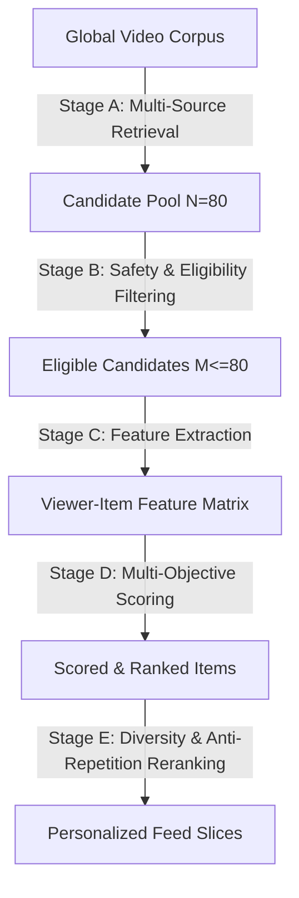

# Project Aurora — PulseRank™ Recommendation Engine Specification

## 1. Executive Summary & Statement of Originality
**PulseRank™** is Project Aurora’s proprietary, explainable multi-objective ranking system designed specifically for short-form video discovery. It is strictly engineered and maintained as an independent recommendation architecture. Project Aurora does not claim to use or imitate any proprietary, private algorithms from external platforms; rather, PulseRank is built upon modern information retrieval, multi-task ranking principles, and transparent user feed controls.

---

## 2. Multi-Stage Pipeline Architecture

### Stage A — Multi-Source Candidate Retrieval (`candidateRetrieval.js`)
Candidates are pooled across five distinct discovery sources:
1. **Followed Accounts Pool**: Recent reels from creators in the user's social graph.
2. **Topic & Interest Pool**: Reels matching the user's explicit interests (`user.interests`) against metadata hashtags.
3. **Creator Affinity Pool**: Creators whose content the viewer previously liked, watched to completion, or saved.
4. **Emerging Creators Pool**: Content published within the past 72 hours by new or rising accounts with growing velocity.
5. **Exploration & Serendipity Pool**: Randomized discovery items outside the viewer's immediate history to prevent filter bubbles.

### Stage B — Safety & Eligibility Filtering (`safetyFilter.js`)
Hard constraints applied prior to scoring:
- **Mutual Blocking**: Excludes authors in viewer's `blockedUsers` or authors who blocked the viewer.
- **Hidden Creators**: Excludes authors explicitly hidden via feed controls (`user.hiddenCreators`).
- **Negative Feedback Suppression**: Excludes any reel marked as `"not_interested"` by the viewer.
- **Private Account Guards**: Enforces privacy; private creators are excluded unless the viewer is an accepted follower.

### Stage C — Feature Extraction (`featureExtractor.js`)
Extracts normalized numerical features $[0.0, 1.0]$:
- $f_{\text{topic}}$: Ratio of overlapping hashtags between user interests and reel tags.
- $f_{\text{author}}$: Historic positive interaction ratio with this creator.
- $f_{\text{follow}}$: Binary indicator ($1.0$ if following, $0.0$ otherwise).
- $f_{\text{freshness}}$: Exponential half-decay over 48 hours: $\exp(-\Delta t_{\text{hours}} / 48)$.
- $f_{\text{engagement}}$: Velocity metric: $\min\left(\frac{\text{likes} + 2 \times \text{comments}}{\max(\text{views}, 1)}, 1.0\right)$.
- $f_{\text{emerging}}$: Rising creator indicator ($1.0$ if creator has $<5$ total posts).
- $f_{\text{repetition}}$: Penalty indicator ($1.0$ if user completed this reel within 14 days).
- $f_{\text{skip}}$: Normalized count of quick skips ($<3$s) on this creator's videos.

### Stage D — Multi-Objective Ranking Formula (`ranker.js`)
$$\text{Score} = V_{\text{positive}} - C_{\text{negative}} + B_{\text{freshness}} + B_{\text{exploration}} - P_{\text{repetition}}$$

Where:
$$V_{\text{positive}} = w_{\text{topic}} f_{\text{topic}} + w_{\text{author}} f_{\text{author}} + w_{\text{engagement}} f_{\text{engagement}} + w_{\text{follow}} f_{\text{follow}}$$
$$C_{\text{negative}} = w_{\text{skip}} f_{\text{skip}}$$
$$B_{\text{freshness}} = w_{\text{freshness}} f_{\text{freshness}}$$
$$B_{\text{exploration}} = w_{\text{exploration}} f_{\text{emerging}}$$
$$P_{\text{repetition}} = w_{\text{repetition}} f_{\text{repetition}}$$

#### Production Model Weights

| Parameter | Symbol | Value | Rationale |
|---|---|---|---|
| Topic Interest Weight | $w_{\text{topic}}$ | `0.35` | Primary driver of topical relevance |
| Creator Affinity Weight | $w_{\text{author}}$ | `0.30` | Rewards relationships with beloved creators |
| Engagement Velocity | $w_{\text{engagement}}$ | `0.20` | Rewards community-validated content quality |
| Social Graph Bonus | $w_{\text{follow}}$ | `0.15` | Prioritizes explicitly followed accounts |
| Historical Skip Penalty | $w_{\text{skip}}$ | `0.40` | Swiftly deprioritizes creators user tends to skip |
| Freshness Decay Bonus | $w_{\text{freshness}}$ | `0.15` | Ensures new content appears without overpowering relevance |
| Emerging Creator Bonus | $w_{\text{exploration}}$ | `0.10` | Guarantees discovery impressions for new creators |
| Repetition Penalty | $w_{\text{repetition}}$ | `0.50` | Strictly suppresses already-watched items |

### Stage E — Final Reranking & Diversity Control (`reranker.js`)
- **Consecutive Creator Cap**: A maximum of 2 consecutive reels from the same creator may appear in the feed.
- **Deterministic Tie-Breaking**: When two items share identical scores, tie-breaking is deterministically resolved using lexicographic order of the reel's unique `ObjectId`.

---

## 3. Telemetry Event Collection & Anti-Cheat Guards
Client watch progress events emitted to `POST /api/reels/:id/events` are validated on the server:
- **Watch Duration Capping**: Untrusted client timestamps are clamped between $0$ and $300$ seconds, preventing clients from fabricating infinite watch hours.
- **Completion Verification**: Video completion is only logged if the client demonstrates continuous playback reaching $\ge 90\%$ of media duration.

---

## 4. User Feed Controls & Transparent Explainability
Every reel in the feed exposes a **"Why am I seeing this?"** modal (`PulseRankExplainModal.jsx`), decomposing the top ranking signals (e.g., *"Matched your interest in #react"*, *"Because you follow @tech_creator"*). Viewers can directly exercise feed autonomy:
- **Not Interested**: Suppresses the video immediately and logs a negative preference signal.
- **Hide Creator**: Adds the author to `user.hiddenCreators`, permanently filtering their content.
- **Reset History**: Allows users to clear past recommendation telemetry and start fresh.
