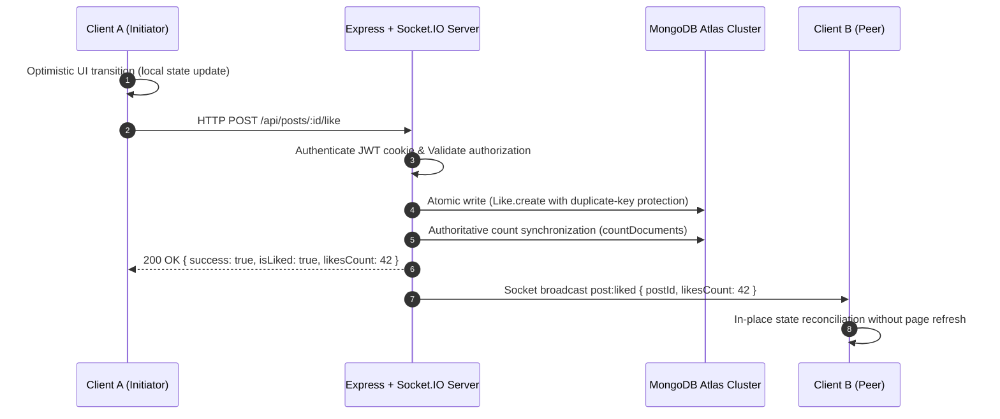

# Project Aurora — Real-Time System Architecture

## 1. Architectural Philosophy
Project Aurora is designed with a **zero-reload** philosophy. Every meaningful user action (likes, comments, bookmarks, follow relationships, story views, social note updates, chat messages, read receipts, and presence changes) updates the initiating client's UI optimistically within < 16ms, validates and persists atomically on the backend, and synchronizes authoritative state to all connected authorized peers over WebSocket connections via Socket.IO.

---

## 2. Real-Time Topology & Event Flow

---

## 3. Authoritative Event Registry

| Domain | Event Name | Emitting Trigger | Target Scope | Authoritative Payload |
|---|---|---|---|---|
| **Posts** | `post:liked` | User likes post | Global / Post Room | `{ postId, likesCount, userId }` |
| **Posts** | `post:unliked` | User unlikes post | Global / Post Room | `{ postId, likesCount, userId }` |
| **Posts** | `post:comment_added` | Comment created | Global / Post Room | `{ postId, comment, commentsCount }` |
| **Posts** | `post:comment_deleted` | Comment removed | Global / Post Room | `{ postId, commentId, commentsCount }` |
| **Stories** | `story:created` | Story published | Followers / Friends | `{ story, author }` |
| **Stories** | `story:viewed` | Story viewed | Author Private Room | `{ storyId, viewersCount, viewerId }` |
| **Stories** | `story:reaction` | Quick emoji reaction | Author Private Room | `{ storyId, emoji, user }` |
| **Notes** | `note:created` | Social note posted | Mutual Followers / Close Friends | `{ note }` |
| **Notes** | `note:deleted` | Note removed/expired | Mutual Followers / Close Friends | `{ noteId, authorId }` |
| **Reels** | `reel:liked` | Reel liked | Global / Reel Room | `{ reelId, likesCount, userId }` |
| **Reels** | `reel:unliked` | Reel unliked | Global / Reel Room | `{ reelId, likesCount, userId }` |
| **Social** | `follower_count_updated` | Follow / Unfollow | Target User Room | `{ userId, followersCount }` |
| **Social** | `following_count_updated` | Follow / Unfollow | Initiator Room | `{ userId, followingCount }` |
| **Presence** | `presence:snapshot` | Socket handshake | Initiator Session | `{ onlineUserIds: [...] }` |
| **Presence** | `presence:online` | User connects | Followers Room | `{ userId }` |
| **Presence** | `presence:offline` | User disconnects | Followers Room | `{ userId, lastActiveAt }` |
| **Chat** | `message:created` | Message sent | Conversation & User Rooms | `{ message, conversationId }` |
| **Chat** | `message:delivered` | Message received | Sender Room | `{ messageId, deliveredTo }` |
| **Chat** | `message:seen` | Message thread viewed | Sender Room | `{ messageId, readBy }` |
| **Chat** | `typing:start` | Keystroke in chat | Conversation Room | `{ userId, username, conversationId }` |
| **Chat** | `typing:stop` | Typing timeout (2s) | Conversation Room | `{ userId, conversationId }` |

---

## 4. Concurrency, Race Condition & Idempotency Safeguards

1. **Unique Compound Indices with Atomic Upserts**:
   - `Like` model uses `{ targetType: 1, targetId: 1, user: 1 }` unique compound index. Concurrent double-clicks trigger MongoDB `E11000 duplicate key` error, which the controller handles idempotently by returning HTTP 200 with the true database count rather than crashing or throwing 409 Conflict.
2. **Authoritative Count Reconciliation**:
   - Counters are verified against actual database records via `countDocuments` rather than relying on unsafe `$inc: 1` increments that can drift over time.
3. **In-Flight Client Locks**:
   - Client interaction buttons (`PostCard.jsx`, `ReelsPage.jsx`, `StoryViewerModal.jsx`) employ `useRef(false)` or state locks to prevent duplicate network calls while a request is actively in-flight.
4. **Presence Multi-Tab Safety**:
   - Presence tracking utilizes an in-memory Map of user active socket IDs (`Set<socketId>`). A user is only marked offline when their final active connection terminates.
